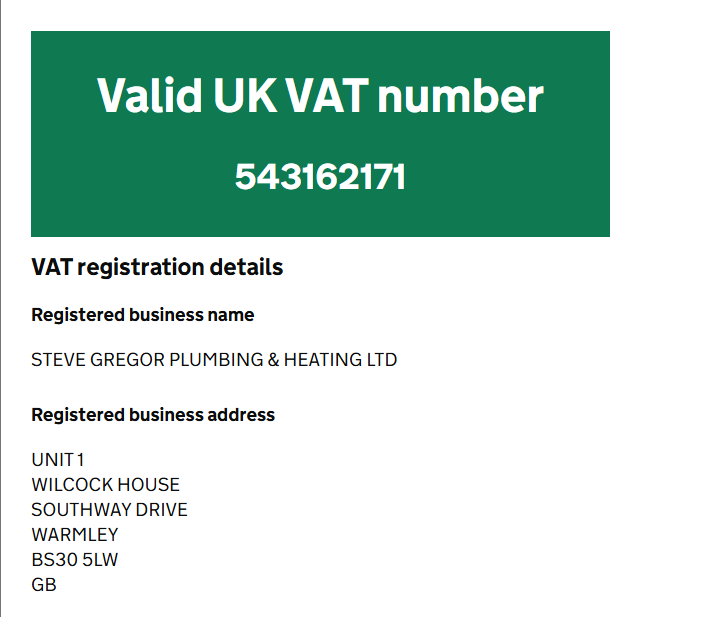
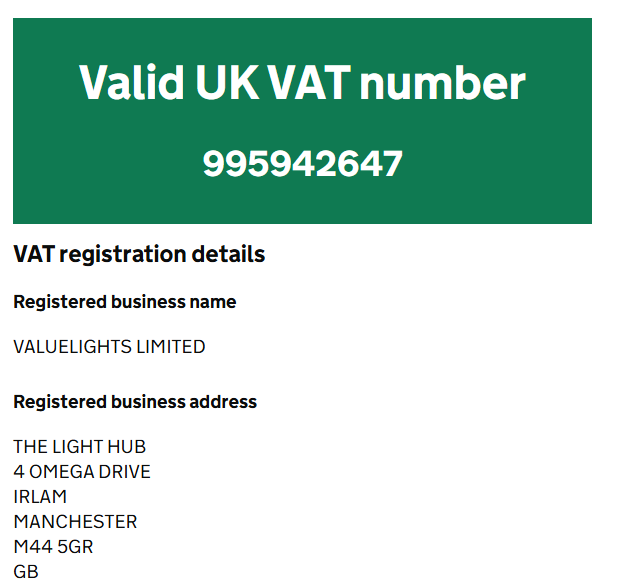
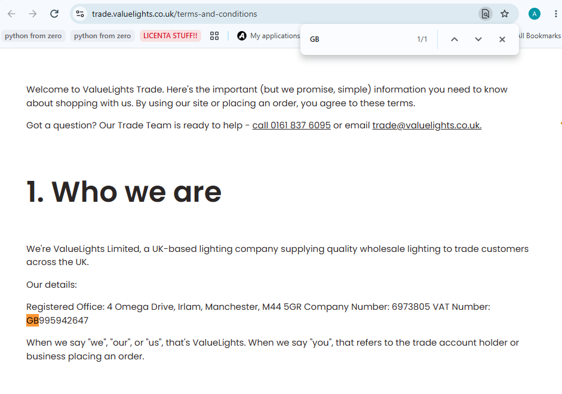
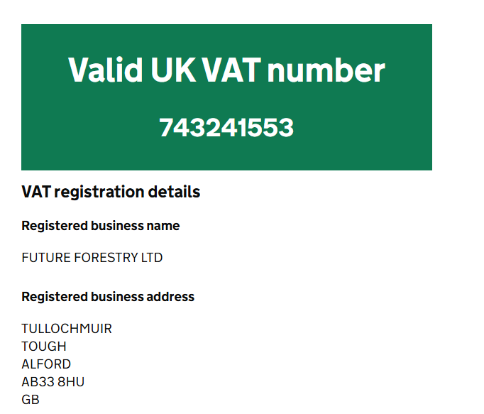
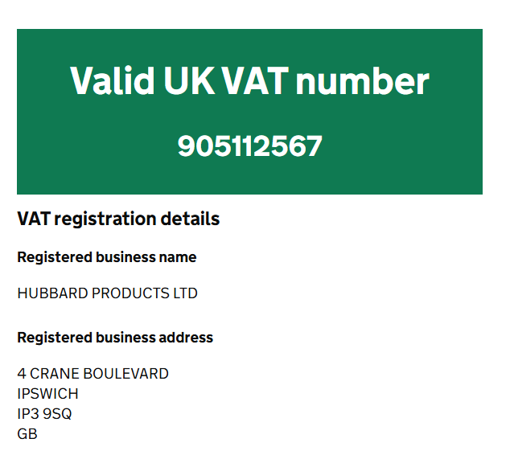
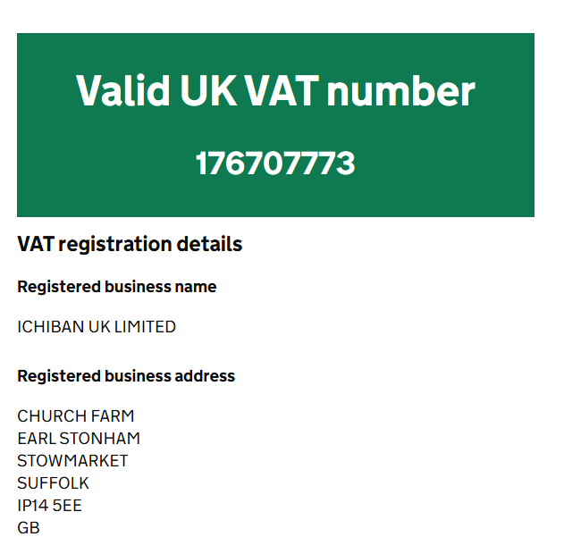
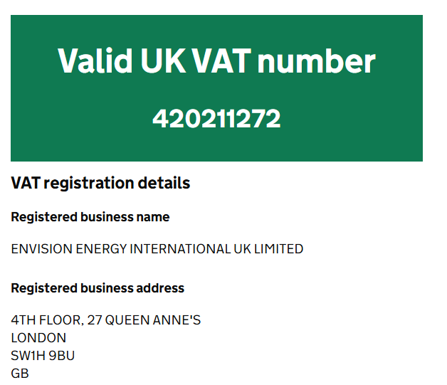
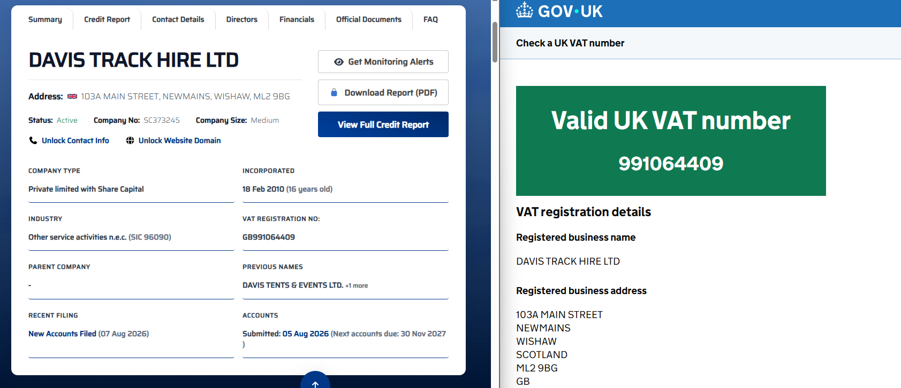
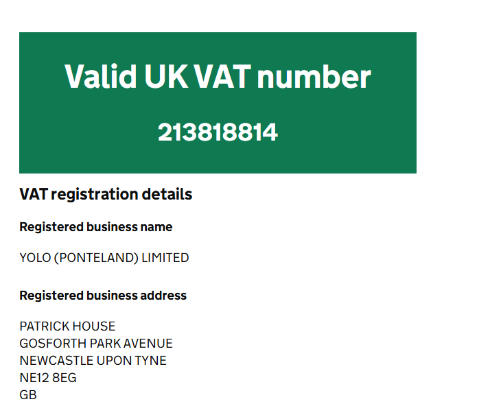

# UK company VAT numbers from the open web: feasibility study

## Summary

- Company websites aren't enough. I had 7 companies that almost certainly have to be VAT-registered, and only 2 of them show their VAT number on their own site.
- My pipeline found 2 of those 7. One was fully automatic. For the other I had to find the domain by hand.
- The final data has no false positives (0/3). But 1 of the 4 numbers that companies published on their own sites was already invalid at HMRC, so the HMRC check has to happen.
- Most "not found" results tell me nothing. For 239 of 250 smaller companies, turnover isn't published, so I can't tell "not registered" apart from "I missed it".
- The numbers do exist, just elsewhere. 4 HMRC-valid numbers were on commercial aggregators and not on the company's own site.

The samples are small. Where it matters, I give intervals.

---

## Part 1: Research

### What I tried, in order

**1. The verifier first (HMRC)**

I wanted the official API, but it needs an authenticated Developer Hub application and I couldn't get one in time. So I automated the public web form instead. My first POST came back 400 because the field is called `target`, not `vatNumber`. After that, 765970776 (Google UK) came back valid and 000000000 came back invalid. I sent 25 requests in a row at about 0.29 s each and wasn't blocked, though that was only a short burst.

HMRC returns the company name, which is useful, and an address. The address often doesn't match Companies House (2 of 3 cases), so I match on name only.

**2. The population (Companies House bulk data)**

`BasicCompanyDataAsOneFile-2026-11-01` has 5,179,256 active companies. The brief said 4.2M, but I counted only companies with status "Active". The file has no VAT numbers and no websites.

**3. Company websites (legal disclosure)**

On paper this looked like the answer. Companies must show their company number on their website (2015 regulations), and VAT-registered businesses must show their VAT number (2002 regulations). If both are on one page, that gives an exact join to Companies House.

My first test used 14 brands I picked myself, so it's biased and only counts as exploration. VAT numbers showed up on 2 of the 14. For Gymshark I checked by hand that the number really isn't on the site.

**4. Common Crawl (CDX index)**

I hoped to get archived legal pages without hitting company servers at all. Homepages were archived, but the /terms pages carrying the VAT number weren't, in both test cases. I also got 429s until I added delays. I dropped per-company lookups. I only tested 2 sites, though, so I'm not ruling out Common Crawl in bulk through the Parquet URL index. I just couldn't run that on a laptop.

**5. EORI**

EORI is GB + VAT number + 000, so in theory it's a second route. In practice there's no public directory, and eorichecker.eu blocks automated access. Dropped.

**6. Finding the company's website**

| Method | Result on sample C (100) | Decision |
|---|---|---|
| Guess domain from name | 2 VAT candidates; 31 sites belonged to other companies | keep, but needs strict checks |
| Wikidata (company no. → website) | 2/100 (B: 0/250) | keep, tiny coverage |
| Google search API | closed to new customers | not possible |
| Brave search API | paid only (2026) | no budget |
| Manual, AI-assisted (20 companies) | own site 7, group site 5, no site 5, unclear 2 | used as an upper bound |

**7. Proving the site belongs to the company**

I accept a site only if it shows the company's own number, or its name plus its registered postcode. If the site shows a different company number, it's a group site and I reject it.

That last rule came from a bug I hit on real data. Group sites (lr.org, orchid-ortho.com, stg.com) were passing on name + postcode, because subsidiaries share the parent's registered office. Now a different company number always wins. The checks also caught a parked domain (envisionenergy.com redirecting to domaineasy.com).

Of the 12 sites that really were the company's own, 5 didn't serve my crawler: 2 returned HTTP 403 (one of them only on /contact) and 3 timed out.

**8. Is "not found" a miss or a true negative?**

Registration is compulsory above £90k turnover. If a company's accounts show more than that in a taxable activity, a missing number is my failure, not theirs. So I pulled the latest accounts (iXBRL) from the Companies House API and extracted turnover.

That turned up a list of problems:

- For 82 of 100 large companies, turnover wasn't machine-readable, mostly because they file PDFs.
- Hubbard's turnover is written in the document but not tagged, so I added a text fallback.
- I was reading `AA01` filings as accounts by mistake. Now I only read annual accounts.
- Holding companies report group turnover, so they go in a separate class.
- LLPs have no SIC code, which hides exempt activity such as care homes. Also a separate class.

That left 7 companies in sample C that should be registered. In sample B (smaller companies) there were none outside the large stratum, because 239 of 250 don't publish turnover.

**9. Aggregators (found by accident)**

While checking misses by hand, I found numbers for Hubbard, Ichiban, Envision and Davis Track Hire on CompanyCheck / Endole-type sites. All four are valid at HMRC, and none of them appear on the company's own site. CompanyCheck blocked my fetch, and Endole's free page doesn't show VAT. I use aggregators only as a reference for measuring recall, never as a source.

### Dead ends and traps

| What | Expected | What happened |
|---|---|---|
| Domain guessing | most sites | 31/100 guessed sites were someone else's |
| Wikidata | free links | 2/100, 0/250 |
| Common Crawl per company | legal pages | not archived (2/2) |
| Turnover from accounts | classify every miss | readable for 18/100 large, ~0 small |
| AI search answers | faster annotation | mixed up a UK holding company with a Cypriot namesake (Tibbetts); suggested a sister company's number (Mediplus) |
| Number on own site = valid | yes | wrong twice: Snowbird `927328019` and PCM `812960238` pass the checksum but are invalid (stale) at HMRC |

---

## Part 2: Proof of concept

### Data used (not in the repo)

The source is `BasicCompanyDataAsOneFile-2026-11-01.csv` from the Companies House Free Company Data Product (1 Nov 2026). It's over GitHub's 100 MB limit, so it isn't in the repo. To reproduce, download that snapshot and run `python sample.py BasicCompanyDataAsOneFile-2026-11-01.csv --seed 42`. The drawn samples are committed in `samples/`.

### Sample

| Sample | Size | From | Question it answers |
|---|---|---|---|
| A, random | 200 | all active | what the customer would see |
| B, stratified | 250 (5 × 50, no dormant) | non-dormant | where the method works |
| C, large filers | 100 | FULL / GROUP / MEDIUM accounts | recall, where "not found" is mostly a miss |

None of these are companies I knew beforehand, and the 14-brand test is excluded from every result.

One mistake I caught: B's `large` stratum is the same 50 companies as part of C, because both drew from the same pool with the same seed. So B adds only 200 new companies, and I report large companies from C.

### Pipeline

```
sample.py      Companies House CSV -> samples A / B / C
discover.py    company number -> candidate sites (Wikidata)
find_sites.py  guess + candidates -> crawl home + legal pages -> prove ownership -> VAT candidates
vat_extract.py regexes for VAT / EORI / company number + HMRC mod-97 checksum
turnover.py    Companies House accounts -> turnover -> "should this company be registered?"
HMRC check     every number: valid AND name matches the company
```

There are 47 tests. Several came from cases that broke on real data.

### Results on sample C: the 7 companies that should be registered

Screenshots of every HMRC check are in the repo root and shown below.

| Company | VAT | HMRC | On own site | Pipeline | Evidence |
|---|---|---|---|---|---|
| Steve Gregor Plumbing and Heating | 543162171 | valid | yes | found (hand-found domain) | [543162171_steve_gregor_hmrc.png](543162171_steve_gregor_hmrc.png) |
| ValueLights | 995942647 | valid | yes | found (automatic) | [995942647_valuelights_hmrc.png](995942647_valuelights_hmrc.png), [995942647_valuelights_website_terms.png](995942647_valuelights_website_terms.png) |
| Hubbard Products | 905112567 | valid | no | missed | [905112567_hubbard_products_hmrc.png](905112567_hubbard_products_hmrc.png) |
| Ichiban UK | 176707773 | valid | no | missed | [176707773_ichiban_uk_hmrc.png](176707773_ichiban_uk_hmrc.png) |
| Envision Energy International UK | 420211272 | valid | no | missed | [420211272_envision_energy_hmrc.png](420211272_envision_energy_hmrc.png) |
| Davis Track Hire | 991064409 | valid | no | missed | [991064409_davis_track_hire_aggregator_and_hmrc.png](991064409_davis_track_hire_aggregator_and_hmrc.png) |
| Merit Office Installations | not found anywhere | n/a | no | missed | n/a |

| Metric | Value | 95% interval |
|---|---|---|
| Recall (found / should be registered) | **2/7 = 29%** | 8–64% |
| Fully automatic | 1/7 = 14% | 3–51% |
| Number on own website (ceiling for any crawler) | 2/7 = 29% | 8–64% |

The pipeline found every number that was actually on a company's own site. Everything it missed was somewhere else.

### HMRC screenshots

Found by the pipeline:

| | |
|---|---|
| <br>Steve Gregor, 543162171 | <br>ValueLights, 995942647 |
| <br>ValueLights: number on its own terms page | <br>Future Forestry, 743241553 (sample B) |

Missed by the pipeline (numbers found by hand on aggregators):

| | |
|---|---|
| <br>Hubbard Products, 905112567 | <br>Ichiban UK, 176707773 |
| <br>Envision Energy International UK, 420211272 | <br>Davis Track Hire, 991064409 (aggregator page + HMRC) |

The rejected-site case:

<br>Yolo (Ponteland): the real number is 213818814, not 455078773 from the guessed site.

### False positives

A false positive is a number that's invalid at HMRC, or one where HMRC's name isn't this company. I measured this on every number the pipeline produced, across C and B.

| Stage | Result |
|---|---|
| Candidates from verified company sites | 4 |
| Rejected by HMRC (stale) | 1/4 (Parking Control Management, `812960238`) |
| Final numbers | 3: Gregor, ValueLights, Future Forestry ([743241553_future_forestry_hmrc.png](743241553_future_forestry_hmrc.png)) |
| **False positives** | **0/3** (interval 0–56%; too few to be precise) |

Name matching needs normalising: HMRC writes "& ... LTD" where Companies House writes "AND ... LIMITED".

The more interesting part is the wrong numbers the checks kept out. A guessed site for Yolo (Ponteland), yolo.co.uk, carried `455078773`, but only the name matched, so it was rejected. The real number is `213818814` ([213818814_yolo_ponteland_hmrc.png](213818814_yolo_ponteland_hmrc.png)). Mediplus Holdings has a valid number floating around, but it belongs to the sister company Mediplus Ltd. On top of those: the group sites, the parked domain, and 31 sites belonging to other companies.

### Results on sample B (200 new companies)

| Stratum | No site | Site not theirs | Own site, no VAT | VAT found |
|---|---|---|---|---|
| micro | 24 | 24 | 2 | 0 |
| small | 25 | 22 | 2 | 1 (Future Forestry) |
| no accounts yet | 31 | 15 | 2 | 0 |
| subsidiary | 32 | 10 | 7 | 0 |

Only 14 of 200 (7%) had a site I could prove was theirs. For small companies the hard part is finding the site. Reading it is easy.

### What my numbers don't capture

- **Small n.** 7 reference companies and 3 final numbers. The direction is clear, but the exact rates aren't.
- **A biased reference.** It leans toward numbers I could find. A company whose number isn't public anywhere, like Merit, can't show up.
- **C is 2% of companies.** The customer's suppliers are mostly small, and that's where I can't measure recall at all.
- **VAT groups.** A subsidiary may legally use the group's number. I count that as "not this company's", so I undercount groups.
- **Crawler limits.** No JavaScript, homepage plus 5 legal pages, one host only.

---

## Part 3: With real resources

### What limits coverage, and whether money fixes it

| Limit | Money fixes it? | My evidence |
|---|---|---|
| Number not on the website | no | 2/7 own-site ceiling |
| Finding the right site | yes (search API, annotation) | guessing 2/100 vs manual 7/20 own sites |
| Blocked / JS sites | yes (proxies, headless) | 5/12 correct sites refused or timed out |
| Knowing who should be registered | partly (OCR on PDF accounts) | 82/100 unreadable |
| Holdings / VAT groups | no (not public) | ~half of sample C |

So a bigger crawler can reliably reach the ~30% ceiling, but it can't get past it. For that you need a different source.

### What I would do

1. Get the crawler to the ceiling. That means a search API (the company number in quotes; name + postcode), headless rendering only when a page needs it, crawling subdomains, and proxies only for sites that block.
2. Find out where the aggregators get their numbers. I'd ask 2–3 vendors for a licence quote and compare their cost per *verified* number with crawling.
3. Use the customer's own invoices. Every VAT invoice has to show the supplier's number, so OCR it, check it at HMRC and attach it. That covers exactly the suppliers they actually pay.
4. Deduplicate without VAT by matching each supplier to a Companies House number on name + address. Same company number, same supplier.
5. Run OCR on PDF accounts to work out who *should* have a number.

### Rough cost (assumptions stated so you can argue with them)

| Item | Per company |
|---|---|
| Search API, 2 queries (~$5/1,000) | ~$0.010 |
| Crawl ~6 pages | ~$0.001 |
| Headless for ~30% of sites | ~$0.003 |
| Proxies for ~20% of sites | ~$0.01 |
| HMRC API | $0 (rate-limited) |
| Audit, 1% of records, ~2 min each | ~$0.007 |
| **Total** | **≈ $0.03** |

If ~30% of companies are registered and websites show the number for ~30% of those, yield is about 9%, which works out to roughly $0.33 per verified number. Across ~4.6M non-dormant companies that's about $140k for about 400k numbers. A data licence has to beat that price.

### What breaks first

1. **The HMRC rate limit.** At ~3 req/s, 1.5M checks take about 6 days. Monthly re-checks need a higher limit agreed with HMRC.
2. **Anti-bot blocking.** It already hit 5 of 12 sites in a small sample, and /contact pages get blocked first.
3. **Group numbers.** They creep in as coverage grows, and precision drops without anything obviously failing.
4. **Search quality.** Results fill up with directories and namesakes.

### What I would monitor

- Yield and HMRC pass rate per source, weekly.
- Coverage of "expected registered" companies per stratum, as a proxy for recall.
- Counts of rejected sites (other company number, name only, parked).
- Share of records not re-checked at HMRC within the SLA.
- A monthly audit sample per stratum.
- Mismatches between customer invoices and our records.

---

# Debate topics

## 1. Brute-forcing HMRC with the checksum

I sampled random 9-digit strings and about 2.1% pass the checksum. That's roughly 21M candidates, or about 81 days at ~3 req/s. You'd end up with every registration, including names and addresses.

I think it's a bad idea, for three reasons. First, it doesn't solve the problem: HMRC gives you no company number back, so you're matching on name again. Second, a lot of those records are sole traders, which means personal names and home addresses. Third, it misuses a verification service and puts at risk the API access the product depends on.

I did use the checksum, but differently: as a free local filter, and as a way to tell a typo from a stale number (Snowbird, PCM).

## 2. Keeping it current

Verification and discovery need different schedules. Re-checking every known number at HMRC is cheap, so do it continuously on a schedule. Discovery is expensive, so re-run it only when something happens: a new company, new accounts showing more than £90k, or a number turning invalid.

They have to be separate because VAT registration and deregistration don't trigger anything at Companies House. My own sample shows how fast numbers go stale: 2 numbers that companies display on their sites right now are already invalid at HMRC (Snowbird, PCM).

## 3. Knowing it's wrong, with no complete reference

Every record gets an HMRC check: the number is valid *and* the name matches after normalising ("&" = "AND", "LTD" = "LIMITED"). On top of that, a monthly random audit per stratum gives precision with an interval.

The red flags to watch for are one number attached to many companies (a VAT group or an error), and an expected-registered company with no number (a recall gap). For drift: if yield from one source drops suddenly, the source broke, not the companies.

The best ground truth is still the customer's own invoices, compared against our record.

## 4. Sources: product vs not

| Would use in the product | Would not use |
|---|---|
| Company's own website (legal disclosure, URL kept) | Aggregators (CompanyCheck, Endole): unknown source, anti-bot, database right |
| Companies House (open data) | AI search answers: mixed up entities (Tibbetts / Cyprus, Mediplus Ltd vs Holdings) |
| HMRC API | HMRC web form scraping |
| Wikidata (CC0) | Checksum enumeration |

I did use aggregators in this study, but only as a reference for recall.

---

# Beyond the UK

## UK vs Germany

| | UK | Germany |
|---|---|---|
| Discovery | hard: number on own site for 2/7 | easier: the mandatory *Impressum* page must show the USt-IdNr. |
| Verification | easy: HMRC returns name + address | hard: VIES returns no name for DE |
| "No number" means | probably not registered | *not* "not registered": the USt-IdNr. is issued only on request |
| Entity proof | company no. + VAT in footer | HRB + USt-IdNr. on the same Impressum |

Would my pipeline survive in Germany? I think the extraction part would and the verification part wouldn't. Without a name from VIES, the verifier can't catch a number that belongs to the wrong company, so the whole burden falls on the audit.

## Where the number doesn't need discovering

In France the VAT number is FR + key + SIREN, where key = (12 + 3 × (SIREN mod 97)) mod 97. You compute it. You don't need to find it. VIES then only tells you whether it's active. Belgium works the same way: VAT = BE + enterprise number.

That changes the order I'd go in. I'd start with France and Belgium, then Germany, and leave the UK for last. The ranking questions are:

1. Can the number be derived from a public ID?
2. Does the verifier return the name?
3. Is there a standard disclosure page?

## Countries by difficulty

| Country | Discovery | Verification |
|---|---|---|
| UK | hard | easy |
| Germany | easier | hard |
| Spain | hard | hard (no name from VIES) |
| France / Belgium | trivial | easy |

---

### Sources
- HMRC rate limit: https://apis.io/rate-limits/hmrc/hmrc-rate-limits/
- Impressum, USt-IdNr. "sofern vorhanden": https://www.ihk.de/dresden/hauptnavigation/recht-steuern/merkblaetter-von-a-bis-z/impressum--6697212
- USt-IdNr. only on request: https://www.it-recht-kanzlei.de/duerfen-kleinunternehmer-umsatzsteueridentifikationsnummer-beantragen.html
- VIES, no name for DE/ES: https://www.vatstack.com/articles/what-is-vies
- French key: https://l-expert-comptable.com/calculateurs/trouver-le-numero-de-tva-intracommunautaire-partir-de-votre-numero-de-siren.html
- Belgian VAT = enterprise number: https://lookuptax.com/docs/tax-identification-number/belgium-tax-id-guide
